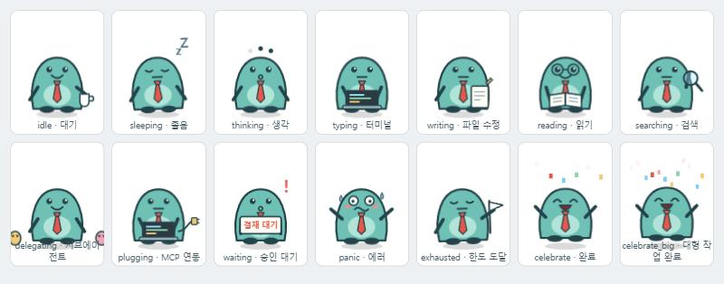

# Agent Buddy

> **혼자 일하는 Claude 옆에, 같이 야근해 줄 동료를 앉혀 주세요.**

Agent Buddy는 Claude 데스크톱 창 아래에 사는 작은 직장인이에요.

Claude가 코드를 읽으면 안경을 고쳐 쓰고, 파일을 고치면 메모장을 꺼내고, 터미널을 돌리면 노트북을 두드려요.
결재가 필요할 땐 "결재 대기" 팻말을 들고 얌전히 기다리고, 일이 끝나면 색종이를 뿌리며 퇴근각을 잽니다.
가끔은 에러에 허둥대고, 한도에 걸리면 백기를 들고, 할 일이 없으면 꾸벅꾸벅 졸기도 해요.

설치는 한 줄. 그다음부터는 Claude를 켤 때마다 알아서 출근합니다.



## 이런 동료예요

- **🖥️ Claude 창에 딱 붙어 살아요**: 창을 옮기면 따라오고, 다른 앱을 보고 있으면 조용히 자리를 비켜요.
- **🤫 일할 땐 말이 없어요**: 바쁠 땐 몸짓으로만 보여주고, 말은 꼭 알려야 할 때만 해요. 결재 요청, 에러, 한도, 업무 완료.
- **🫳 쓰다듬고 옮길 수 있어요**: 캐릭터 위에서 마우스를 좌우로 살살 문지르면 하트를 띄우며 좋아해요. 클릭하면 폴짝 뛰며 대답하고, 꾹 누른 채 끌면 원하는 자리로 옮겨져요(그 자리를 기억해요).
- **🟢 기분이 한눈에 보여요**: 머리 위 작은 불빛이 초록이면 업무 중, 주황이면 결재 대기, 빨강이면 에러, 회색이면 휴식 중이에요.
- **📋 마우스를 올리면 오늘의 업무 일지**: 프로젝트, 도구 호출 수, 실수한 횟수, 쓴 토큰, 그리고 마신 커피 잔 수(출력 5천 토큰당 한 잔).
- **📏 크기는 마음대로**: 트레이 아이콘에서 작게·보통·크게를 고를 수 있어요.
- **👻 방해하지 않아요**: 캐릭터를 뺀 나머지 영역은 클릭이 그대로 Claude로 넘어가요. "애니메이션 줄이기" 설정도 따라요.
- **🔒 대화 내용은 몰라요**: 이벤트 이름만 받고, 내 컴퓨터 밖으로는 아무것도 보내지 않아요.
- **🆓 무료, 오픈소스.**

## 업무 모션

| Claude Code가 하는 일 | 동료의 모습 |
|---|---|
| 생각 중 | 머리 위 점 세 개 |
| 파일 읽기 | 안경 쓰고 책 읽기 |
| 파일 수정 | 메모장에 끄적끄적 |
| 터미널 명령 | 노트북 타이핑 |
| 웹 검색 | 돋보기 |
| 서브에이전트 | 양옆에 부하직원 등장 |
| MCP 도구 | 플러그 연결 |
| **승인 대기** | "결재 대기" 팻말 + 주황 말풍선 (승인할 때까지 유지) |
| 에러 | 땀 흘리며 허둥지둥 |
| 사용량 한도 | 백기 |
| 작업 완료 | 만세 + 색종이 (도구 10번 이상 쓰면 더 크게) |
| 한동안 조용함 | 꾸벅꾸벅 |

## 구조

```
Claude Code 훅 (hook.mjs)
   │  POST /event  (이벤트명·도구명·프로젝트 폴더명만)
   ▼
로컬 서버 (server.mjs, 127.0.0.1:47821)  ── 상태 머신(lib/state.mjs) + 토큰 집계(lib/transcript.mjs)
   │  SSE /stream
   ▼
오버레이 (overlay/index.html)
   ├─ Electron 투명창 (electron/main.cjs) — Claude 창 하단에 붙음
   └─ 또는 아무 브라우저 탭
```

## 설치 (Claude Code 플러그인, 추천)

Windows, Node 20 이상. Claude Code 입력창에 한 줄:

```
/plugin install agent-buddy --marketplace 03jiho/agent-buddy
```

(Claude Code 2.1.275 이전 버전이면 `/plugin marketplace add 03jiho/agent-buddy` 후 `/plugin install agent-buddy@agent-buddy`)

설치하고 Claude Code를 다시 시작하면 끝입니다.

- 훅은 플러그인이 등록합니다. `settings.json`을 고칠 필요가 없고, 끄거나 지우는 것도 `/plugin`에서 합니다.
- 세션이 시작될 때 오버레이가 안 떠 있으면 알아서 띄웁니다. 처음 한 번은 Electron(약 100MB)을 받느라 1~2분 걸릴 수 있습니다. 진행 상황은 `%TEMP%\agent-buddy-launch.log`에 남습니다.
- Node 24의 Electron 설치 버그도 자동으로 우회합니다.
- 자동 실행을 끄려면 환경변수 `AGENT_BUDDY_AUTOSTART=0`.
- 예전에 수동으로 `settings.json`에 훅을 넣었다면 지워주세요. 남겨두면 이벤트가 두 번씩 들어옵니다.

## 수동 설치

```bash
git clone https://github.com/03jiho/agent-buddy.git
cd agent-buddy
npm install
```

> Node 24에서 `npm install` 뒤 Electron 실행 시 "Electron failed to install correctly"가 나면,
> Electron 압축 해제 라이브러리(extract-zip)가 Node 24에서 첫 파일만 풀고 멈추는 문제입니다.
> Node 22 LTS로 설치하거나, 아래처럼 캐시된 zip을 직접 풀면 됩니다 (PowerShell).
>
> ```powershell
> cd node_modules\electron
> $zip = Get-ChildItem "$env:LOCALAPPDATA\electron\Cache" -Recurse -Filter "electron-v*-win32-x64.zip" | Select-Object -First 1
> tar.exe -xf $zip.FullName -C dist
> Set-Content path.txt electron.exe -NoNewline
> ```

### 1. 훅 등록

```bash
node tools/print-settings.mjs
```

출력된 JSON의 `hooks`를 `~/.claude/settings.json`의 `hooks`에 **병합**합니다. 기존 설정은 지우지 말고, 먼저 백업해두세요.
도구는 파일을 직접 고치지 않습니다. 훅 경로는 `C:/...`처럼 슬래시여야 합니다(Git Bash가 역슬래시를 먹어서 훅이 조용히 안 돌 수 있음). 출력은 이미 슬래시로 나옵니다.

### 2. 서버 실행 (터미널 하나 켜두기)

```bash
node server.mjs
```

### 3. 오버레이 실행

```bash
npm run overlay
```

서버가 이미 떠 있으면 거기에 붙고, 없으면 자체로 띄웁니다. 종료는 트레이 아이콘 → 종료.

### 4. Claude Code 재시작

재시작해야 훅이 적용됩니다. 아무 작업이나 시키면 캐릭터가 반응합니다.

Electron 없이 보고 싶으면 브라우저로 http://127.0.0.1:47821/?bg=1 을 열어도 됩니다 (Claude 데스크톱 앱의 브라우저 패널에 띄워도 됩니다).

## 미리보기 URL

| 주소 | 내용 |
|---|---|
| `/?sheet=1` | 모든 표정 한눈에 |
| `/?demo=1` | 자동 데모 (숫자키 1~9로 표정 강제) |
| `/?mood=waiting` | 특정 상태 고정 |
| `/?size=s` · `m` · `l` | 캐릭터 크기 (56 / 72 / 96px) |
| `/?hud=1` | HUD 항상 표시 |
| `/?bg=1` | 밝은 배경 (투명 대신) |

## 설정 (환경변수)

| 변수 | 기본값 | 설명 |
|---|---|---|
| `AGENT_BUDDY_PORT` | `47821` | 서버 포트 (훅·서버·오버레이 공통) |
| `AGENT_BUDDY_BOTTOM_OFFSET` | `100` | Claude 창 하단에서 몇 px 위에 띄울지 (입력창 위) |
| `AGENT_BUDDY_TARGET` | `claude` | 따라갈 창의 프로세스 이름 |
| `AGENT_BUDDY_AUTOSTART` | `1` | `0`이면 플러그인이 세션 시작 때 오버레이를 띄우지 않음 |

## 문제 해결

- **캐릭터가 안 움직임**: 서버가 떠 있는지 http://127.0.0.1:47821/health 로 확인 → 이벤트가 들어오는지 `/events/recent` 확인 → Claude Code에서 `/hooks`로 등록 확인 → `claude --debug-file log.txt`로 훅 실행 로그 확인.
- **훅은 등록됐는데 이벤트가 없음**: 훅 command 경로에 역슬래시가 있는지 확인.
- **오버레이가 안 보임**: Claude 창이 맨 앞에 있어야 보입니다. 다른 창을 클릭하면 숨는 게 정상입니다.

## 이 플러그인이 실행·전송·다운로드하는 것

숨기는 동작이 없도록 전부 적어둡니다.

**훅 (Claude Code가 실행)**
- 11개 이벤트(SessionStart, UserPromptSubmit, PreToolUse, PostToolUse, PostToolUseFailure, Notification, Stop, StopFailure, SubagentStart, SubagentStop, SessionEnd)마다 플러그인 폴더의 `hook.mjs`를 node로 실행합니다.
- `hook.mjs`는 이벤트 이름, 세션 ID, transcript 파일 경로, 프로젝트 폴더 이름, 도구 이름, 알림 종류만 `http://127.0.0.1:47821`(내 컴퓨터)로 보냅니다. **프롬프트, 도구 입력·출력, 파일 내용은 보내지 않습니다.** 서버가 꺼져 있으면 1.5초 안에 조용히 끝나고, 출력을 남기지 않습니다.
- SessionStart 때 `tools/autostart.mjs`도 실행합니다. `http://127.0.0.1:47821/health`로 오버레이가 떠 있는지 보고, 없으면 `tools/launch-overlay.mjs`를 백그라운드 프로세스로 띄우고 바로 끝납니다. Windows에서만 동작하고, 환경변수 `AGENT_BUDDY_AUTOSTART=0`으로 끌 수 있습니다.

**첫 실행 때 한 번 다운로드 (`tools/launch-overlay.mjs`)**
- 플러그인 폴더에서 `npm install`을 실행합니다. npm 레지스트리에서 Electron 패키지를 받고, Electron 설치 과정이 GitHub(`github.com/electron/electron/releases`)에서 Electron 실행 파일(약 100MB)을 받아 플러그인 폴더의 `node_modules` 안에 둡니다.
- Node 24에서 Electron 압축 해제가 멈추는 버그가 있으면, 받아둔 zip의 SHA-256을 Electron 공식 체크섬과 비교한 뒤 Windows 기본 `tar.exe`로 풉니다.
- 진행 기록은 `%TEMP%\agent-buddy-launch.log`, 동시 실행 방지용 잠금 파일은 플러그인 폴더의 `.launch.lock`입니다.

**오버레이 (Electron, 플러그인 폴더 안에서 실행)**
- 로컬 서버(`server.mjs`)를 `127.0.0.1:47821`에서 엽니다. 127.0.0.1에만 바인딩하고, Host/Origin 검사와 64KB 요청 제한을 합니다.
- 토큰 수를 세려고 `~/.claude` 아래 transcript(`.jsonl`)에서 usage 숫자만 읽습니다. 대화 내용은 읽어서 쓰지 않고, 어디에도 보내지 않습니다.
- Claude 창을 따라가려고 숨겨진 PowerShell 프로세스가 0.2초마다 Windows API(GetForegroundWindow, DwmGetWindowAttribute 등)로 Claude 창의 위치와 맨 앞 여부를 읽습니다.
- 캐릭터만 클릭되게 하려고 마우스 커서 위치를 0.04초마다 읽습니다. 키 입력은 읽지 않습니다.
- 크기 설정은 Electron 사용자 데이터 폴더의 `prefs.json`에, 캐릭터 위치는 오버레이의 localStorage에 저장합니다.

**네트워크**
- 위의 첫 실행 다운로드(npm 레지스트리, GitHub)를 빼면, 모든 통신은 내 컴퓨터 안(`127.0.0.1`)에서만 일어납니다. 원격 서버로 보내는 데이터, 원격 측정(telemetry)은 없습니다.

## 테스트

```bash
npm test
```

7개: 상태 머신, 토큰 집계, 훅→서버 통합 및 민감 정보 유출 검사, 서버가 꺼져 있을 때 훅이 조용하고 빠르게 끝나는지, HTTP 가드, SSE.

## 참고한 앱

- **Bongo Cat**: 작고 거슬리지 않게, 반응만 → 작은 크기, 작업 중엔 말 없이
- **Desktop Mate / Shimeji**: 끌어서 옮기기, 클릭 반응, 크기 선택 (동작 방식만 참고, 캐릭터는 자체 제작)
- **Clippy** (반면교사): 원치 않을 때 끼어들지 않기 → 말풍선은 필요한 순간에만
- **Clawd on Desk, ClaudePet, claude-buddy** 등 Claude Code 펫: 승인 대기 강조, 상태 색 표시

## 한계

- Claude 창 추적은 Windows 전용입니다. PowerShell로 0.2초마다 창 위치를 읽어서, 창을 끌 때 약간 늦게 따라옵니다.
- 프로토타입입니다.

## 후원

Agent Buddy가 마음에 들었다면 동료에게 커피 한 잔 사주세요. 저장소 위쪽의 **Sponsor** 버튼으로 후원할 수 있어요.

## 라이선스

- **코드**: [MIT](LICENSE). 자유롭게 쓰고, 고치고, 배포할 수 있어요.
- **캐릭터 그림** (`overlay/index.html`의 캐릭터 SVG, `assets/`의 이미지): [CC BY-NC-ND 4.0](https://creativecommons.org/licenses/by-nc-nd/4.0/). 출처를 밝히고 비상업적으로, 고치지 않은 채 공유할 수 있어요. 이 앱을 실행하고 배포하는 건 괜찮아요. 상업적 이용이나 캐릭터 변형은 따로 허락이 필요해요. 포크에서 캐릭터를 직접 그린 것으로 바꾸는 건 자유예요.

Agent Buddy는 개인 프로젝트이며 Anthropic과 관련이 없습니다. Claude는 Anthropic의 상표입니다.
